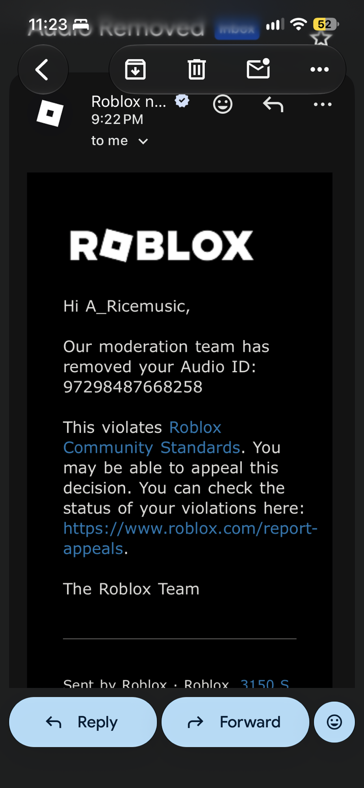

# Audio rejection case: voiceBank01 — 2026-10-30 UTC

## Owner decision and evidence limits

**No further audio uploads. Story continues with subtitles beyond existing approved voices; changed lines stay silent (D-142).** Preserve the pushed evidence tag `evidence/voicebank01-rejected` at commit `ff4a78b`; do not delete that tag or re-upload its files. The original branch `feat/voice-regen` was force-pushed to `86f3661` and no longer contains the rejected files; [PR #161](https://github.com/A-Ricemusic/skybreak/pull/161) is closed. Do not delete the branch either. Keep the HALT. This is a documentation-only record, not an implementation of subtitle routing or an authorization to appeal or upload.

The exact cause is unknown. The ranked candidates below are hypotheses, not a Roblox finding. Prior approval of reused takes does not rule out context, a changed classifier or nondeterministic moderation. Similar acoustic measurements do not prove there was no acoustic trigger. Assertions in the archived investigation such as “almost certainly”, “ruled out”, “any ASR”, and “near-certain second rejection” express that investigator's confidence, not established facts. No new listening or Player test was performed for this case file. Policy and appeal claims below are historical evidence, not freshly verified guidance.

## Incident facts and timeline

| Field | Recorded value |
|---|---|
| Roblox audio asset | `97298487668258` |
| Preserved file | `assets/voice/voiceBank01.ogg`, tag `evidence/voicebank01-rejected`, commit `ff4a78b`; originally feat/voice-regen / PR #161 (now closed) |
| SHA-256 | `26d100894c938b4df8c4a54de4065ac849bca9cec82187ac2ba03e02c0fa6222` |
| Format | Ogg Vorbis, mono, 44.1 kHz, 373.239 seconds, 56 lines |
| Upload | `tools/upload-voice.py`, 2026-10-30 approximately 04:19 UTC |
| Moderation | `MODERATION_STATE_REJECTED`, `2026-10-30T04:19:43Z`; API returned no reason |
| Local stop file | `~/.skybreak-roblox-uploads/HALT-3407487520` (written by uploader) |
| Local journal | `~/.skybreak-roblox-uploads/journal-3407487520.json` |
| Journal key | `voice/voiceBank01-26d100894c93.ogg` |
| Remaining banks | Banks 02 and 03 were not uploaded |
| Earlier model uploads | `107763051422036`, `87111261775563`, `105938775214679`, `86951943477271`: four 3D models approved minutes earlier; this does not prove audio-policy compliance |
| Account outcome | Owner reports no ban or account moderation |

Times and uploader/journal facts above are supplied incident evidence; this documentation task made no Roblox or ElevenLabs API calls. The date is UTC; the owner's email arrived the previous local calendar day.

## Owner email evidence

Owner received this email at **9:22 PM local on 2026-10-29** (America/Los_Angeles; approximately 04:22 UTC on October 30):

> Hi A_Ricemusic, Our moderation team has removed your Audio ID: 97298487668258. This violates Roblox Community Standards. You may be able to appeal this decision. You can check the status of your violations here: https://www.roblox.com/report-appeals.



The screenshot is copied unchanged from the owner attachment `235e02c6-d073-48f7-8b94-ae56242f6890-67edf6a0-ad10-4e27-915b-798375106061.png`. The generic “Community Standards” message does **not** identify a phrase or policy category. No appeal outcome is known.

## Generation and independent pre-upload review

Evidence files at `ff4a78b` under `assets/voice/`: `casting.json` (voices, settings, spoken replacements), `provenance.json` (per-take request IDs/raw hashes/cache keys), `transcripts.json`, `stt.json`, `upload-plan.json`, `checklists/voiceBank01.json`, and `review.json`. These are preserved at the evidence tag, not copied over main's approved bank metadata.

ElevenLabs premade voices, paid Starter plan, model `eleven_turbo_v2_5`; source output `mp3_44100_128`. Casting records commercial use, no cloned/designed voices and no imitation of real people or known characters. Defaults: stability 0.5, similarity_boost 0.75, style 0, use_speaker_boost true, speed 1.0. Bank01 speakers: SERA = Sarah (`EXAVITQu4vr4xnSDxMaL`); TEAL = George (`JBFqnCBsd6RMkjVDRZzb`, tape, stability 0.45); TRAINEE = River (`SAz9YHcvj6GT2YYXdXww`); RUSK = Adam (`pNInz6obpgDQGcFmaJgB`, stability 0.6).

Independent pre-upload reviewer: **Claude Opus 5.5**, `2026-10-30T04:12:29Z`; review head `e6740275489eeeb48ba2f9b5afb64840274cf436`, base `12305e92813ba1d3879ea7400500f600c75452ef`, baseRef `feat/story-18-remap`. Review recorded bank01 `approved: true` for the exact rejected SHA, but **audioListened=false, humanListened=false**; checklist human approval remained false. It reviewed all 168 transcript/STT lines across three banks, casting/provenance, hashes and measurements. This evidence-only approval did not certify acoustic delivery or Roblox acceptance. It also conditioned making the banks audible on in-experience AI disclosure; that is not an identified rejection cause.

Bank01 STT: ElevenLabs `scribe_v1`, 56 lines, mean match **0.9862**, minimum **0.864**, no unresolved flagged lines. Accepted under-90 scores: `story.c05.b01` 0.864 (Merel/Meril, quays/keys, harbours/harbors), `story.c05.b05` 0.895 (quays/keys, neighbours/neighbors), `story.c07.b04` 0.889 (Sera/Sarah). The reviewer treated these as homophone/spelling differences. The later rejection investigation instead identified the contextual “keys” reading as the leading suspect. Scores were not raised to conceal differences; word-recall scoring does not penalize inserted words.

Exact bank01 pre-upload review record (including policy sources and contextual flags):

```json
{
  "sha256": "26d100894c938b4df8c4a54de4065ac849bca9cec82187ac2ba03e02c0fa6222",
  "approved": true,
  "reviewer": "Claude Opus 5.5 (independent reviewer agent)",
  "method": "Independent manual review of all 168 exact and spoken transcript lines and all 168 cached STT heard strings for moderation (profanity, slurs, sexual content, personal info, real people/brands, copied Ace Combat dialogue/names, all-ages fictional combat), against the Roblox Terms of Use, Community Standards, audio asset guidelines and Audio Upload License Agreement as fetched 2026-10-30T04:05-04:12Z. SHA-256 recomputed and matched to upload-plan.json, stt.json and checklist; .ogg bytes unchanged since a8d9ab4. Bank membership, VoiceCues.ts regions/text, RelayStory.ts subtitles (122 lines) and story-script.json (168 rows) all agree with transcripts.json. Per-region RMS confirms speech in every region; integrated loudness -16.2 LUFS, peaks <= -0.6 dBFS; Ogg Vorbis mono 44.1 kHz, under 6.5 min and 20 MB. All 16 cast voice ids recorded as premade in the cached /v1/voices category evidence (8 used); all 168 provenance cacheKeys recomputed from casting, raw take SHA-256s and requestIds match the generation cache, every generation request text equals the spoken text, tier starter. STT scores re-derived (tools/voice.py stt-offline reproduces stt.json exactly) and cross-checked with an independent word-LCS recall; all 30 lines with any heard-text difference inspected and every sub-90% line compared word for word. Text + STT + casting evidence review only: no human listened to any bank or sampler.",
  "humanListened": false,
  "audioListened": false,
  "note": "No human listened and the reviewer agent did not listen to audio. Approval is limited to transcript + STT + casting/provenance evidence; it does not certify actual acoustic delivery, absence of every possible mis-synthesis, or a Roblox moderation outcome. Existing checklist humanReview.approved remains false.",
  "transcriptMatch": {
    "engine": "ElevenLabs scribe_v1 (cached word-timestamp transcript); scores re-derived offline and cross-checked with independent word-LCS recall",
    "lines": 56,
    "meanRate": 0.9862,
    "minRate": 0.864,
    "flagged": [],
    "acceptedUnder90": [
      {
        "id": "story.c05.b01",
        "rate": 0.864,
        "reason": "Fictional-name homophone Merel \u2192 Meril and quays \u2192 keys; harbours \u2192 harbors is British/American spelling. Cached transcript retains the words and meaning."
      },
      {
        "id": "story.c05.b05",
        "rate": 0.895,
        "reason": "Homophone quays \u2192 keys and British/American spelling neighbours \u2192 neighbors; no dialogue omitted in cached STT."
      },
      {
        "id": "story.c07.b04",
        "rate": 0.889,
        "reason": "Fictional-name homophone Sera \u2192 Sarah; all other words match cached STT."
      }
    ],
    "note": "minRate is the true unadjusted score; accepted fictional-name homophone, British/American spelling, compound-tokenisation and number-formatting differences are not silently raised to 90% or 100%. Word-recall scoring does not penalize inserted words; all heard strings were read and contain no unexpected words."
  },
  "contextualFlags": [
    {
      "lineIds": [
        "story.c02.b04"
      ],
      "reason": "Trainees called kids in a surveillance context; no sexualization or exploitative detail. Fictional aviation training; nonblocking."
    },
    {
      "lineIds": [
        "story.c03.b00"
      ],
      "reason": "Invented Teklan transcribed as 'tech land', a possible incidental brand sound-alike (precedent noted Techland). Fictional farmers, no company or endorsement; nonblocking."
    },
    {
      "lineIds": [
        "story.c03.b01",
        "story.c03.b02",
        "story.c04.b04"
      ],
      "reason": "Patrols firing on evacuation trucks; antagonist erasing a witness. No gore or endorsement of civilian attacks; fictional antagonist wrongdoing; nonblocking."
    }
  ]
}
```

## Offline investigation procedure (no uploads)

Work in a local scratch directory. Restore the rejected bytes from Git, not Roblox; preserve the evidence tag:

```sh
mkdir -p /tmp/skybreak-audio-case/regions
git show evidence/voicebank01-rejected:assets/voice/voiceBank01.ogg > /tmp/skybreak-audio-case/voiceBank01.ogg
shasum -a 256 /tmp/skybreak-audio-case/voiceBank01.ogg
ffprobe -v error -show_format -show_streams /tmp/skybreak-audio-case/voiceBank01.ogg
git show origin/main:assets/voice/voiceBank01.ogg > /tmp/skybreak-audio-case/approved-bank01.ogg
git show origin/main:assets/voice/upload-plan.json > /tmp/skybreak-audio-case/approved-upload-plan.json
git show evidence/voicebank01-rejected:assets/voice/upload-plan.json > /tmp/skybreak-audio-case/rejected-upload-plan.json
```

The approved old bank01 is asset **96143096268975**, SHA prefix `9ac91ce8`; main's `assets/voice/upload-plan.json` holds its exact cue regions. Pin the main revision used in any subsequent comparison, because main can change. Old/new IDs are not interchangeable: the full table below maps each reused take to its old cue and bank (some are in old bank02). Use the old plan's times for old bytes, never the new region times. Compare `provenance.json` requestId and rawSha256 by that mapping, as well as exact text. Lossy repacking can change encoded bank bytes even when the raw take is identical.

Each command below decodes the rejected bank and trims the documented start/end region (seconds) to PCM WAV. Times reproduce the investigation's two-decimal regions; for sample-precise boundaries consult the preserved upload plan. These commands are instructions, not a claim that this documentation task listened to the extracted files.

```sh
ffmpeg -nostdin -n -v error -i /tmp/skybreak-audio-case/voiceBank01.ogg -af "atrim=start=0.25:end=8.27,asetpts=PTS-STARTPTS" -c:a pcm_s16le /tmp/skybreak-audio-case/regions/story.c00.b00.wav
ffmpeg -nostdin -n -v error -i /tmp/skybreak-audio-case/voiceBank01.ogg -af "atrim=start=8.52:end=15.79,asetpts=PTS-STARTPTS" -c:a pcm_s16le /tmp/skybreak-audio-case/regions/story.c00.b01.wav
ffmpeg -nostdin -n -v error -i /tmp/skybreak-audio-case/voiceBank01.ogg -af "atrim=start=16.04:end=22.96,asetpts=PTS-STARTPTS" -c:a pcm_s16le /tmp/skybreak-audio-case/regions/story.c00.b02.wav
ffmpeg -nostdin -n -v error -i /tmp/skybreak-audio-case/voiceBank01.ogg -af "atrim=start=23.21:end=29.02,asetpts=PTS-STARTPTS" -c:a pcm_s16le /tmp/skybreak-audio-case/regions/story.c00.b03.wav
ffmpeg -nostdin -n -v error -i /tmp/skybreak-audio-case/voiceBank01.ogg -af "atrim=start=29.27:end=33.62,asetpts=PTS-STARTPTS" -c:a pcm_s16le /tmp/skybreak-audio-case/regions/story.c00.b04.wav
ffmpeg -nostdin -n -v error -i /tmp/skybreak-audio-case/voiceBank01.ogg -af "atrim=start=33.87:end=37.60,asetpts=PTS-STARTPTS" -c:a pcm_s16le /tmp/skybreak-audio-case/regions/story.c00.b05.wav
ffmpeg -nostdin -n -v error -i /tmp/skybreak-audio-case/voiceBank01.ogg -af "atrim=start=37.85:end=43.85,asetpts=PTS-STARTPTS" -c:a pcm_s16le /tmp/skybreak-audio-case/regions/story.c01.b00.wav
ffmpeg -nostdin -n -v error -i /tmp/skybreak-audio-case/voiceBank01.ogg -af "atrim=start=44.10:end=50.99,asetpts=PTS-STARTPTS" -c:a pcm_s16le /tmp/skybreak-audio-case/regions/story.c01.b01.wav
ffmpeg -nostdin -n -v error -i /tmp/skybreak-audio-case/voiceBank01.ogg -af "atrim=start=51.24:end=59.93,asetpts=PTS-STARTPTS" -c:a pcm_s16le /tmp/skybreak-audio-case/regions/story.c01.b02.wav
ffmpeg -nostdin -n -v error -i /tmp/skybreak-audio-case/voiceBank01.ogg -af "atrim=start=60.18:end=67.71,asetpts=PTS-STARTPTS" -c:a pcm_s16le /tmp/skybreak-audio-case/regions/story.c01.b03.wav
ffmpeg -nostdin -n -v error -i /tmp/skybreak-audio-case/voiceBank01.ogg -af "atrim=start=67.96:end=74.16,asetpts=PTS-STARTPTS" -c:a pcm_s16le /tmp/skybreak-audio-case/regions/story.c01.b04.wav
ffmpeg -nostdin -n -v error -i /tmp/skybreak-audio-case/voiceBank01.ogg -af "atrim=start=74.41:end=80.81,asetpts=PTS-STARTPTS" -c:a pcm_s16le /tmp/skybreak-audio-case/regions/story.c01.b05.wav
ffmpeg -nostdin -n -v error -i /tmp/skybreak-audio-case/voiceBank01.ogg -af "atrim=start=81.06:end=84.66,asetpts=PTS-STARTPTS" -c:a pcm_s16le /tmp/skybreak-audio-case/regions/story.c01.b06.wav
ffmpeg -nostdin -n -v error -i /tmp/skybreak-audio-case/voiceBank01.ogg -af "atrim=start=84.91:end=93.21,asetpts=PTS-STARTPTS" -c:a pcm_s16le /tmp/skybreak-audio-case/regions/story.c02.b00.wav
ffmpeg -nostdin -n -v error -i /tmp/skybreak-audio-case/voiceBank01.ogg -af "atrim=start=93.46:end=97.92,asetpts=PTS-STARTPTS" -c:a pcm_s16le /tmp/skybreak-audio-case/regions/story.c02.b01.wav
ffmpeg -nostdin -n -v error -i /tmp/skybreak-audio-case/voiceBank01.ogg -af "atrim=start=98.17:end=107.02,asetpts=PTS-STARTPTS" -c:a pcm_s16le /tmp/skybreak-audio-case/regions/story.c02.b02.wav
ffmpeg -nostdin -n -v error -i /tmp/skybreak-audio-case/voiceBank01.ogg -af "atrim=start=107.27:end=115.78,asetpts=PTS-STARTPTS" -c:a pcm_s16le /tmp/skybreak-audio-case/regions/story.c02.b03.wav
ffmpeg -nostdin -n -v error -i /tmp/skybreak-audio-case/voiceBank01.ogg -af "atrim=start=116.03:end=123.38,asetpts=PTS-STARTPTS" -c:a pcm_s16le /tmp/skybreak-audio-case/regions/story.c02.b04.wav
ffmpeg -nostdin -n -v error -i /tmp/skybreak-audio-case/voiceBank01.ogg -af "atrim=start=123.62:end=131.06,asetpts=PTS-STARTPTS" -c:a pcm_s16le /tmp/skybreak-audio-case/regions/story.c02.b05.wav
ffmpeg -nostdin -n -v error -i /tmp/skybreak-audio-case/voiceBank01.ogg -af "atrim=start=131.31:end=135.12,asetpts=PTS-STARTPTS" -c:a pcm_s16le /tmp/skybreak-audio-case/regions/story.c02.b06.wav
ffmpeg -nostdin -n -v error -i /tmp/skybreak-audio-case/voiceBank01.ogg -af "atrim=start=135.37:end=145.04,asetpts=PTS-STARTPTS" -c:a pcm_s16le /tmp/skybreak-audio-case/regions/story.c03.b00.wav
ffmpeg -nostdin -n -v error -i /tmp/skybreak-audio-case/voiceBank01.ogg -af "atrim=start=145.29:end=154.26,asetpts=PTS-STARTPTS" -c:a pcm_s16le /tmp/skybreak-audio-case/regions/story.c03.b01.wav
ffmpeg -nostdin -n -v error -i /tmp/skybreak-audio-case/voiceBank01.ogg -af "atrim=start=154.51:end=160.82,asetpts=PTS-STARTPTS" -c:a pcm_s16le /tmp/skybreak-audio-case/regions/story.c03.b02.wav
ffmpeg -nostdin -n -v error -i /tmp/skybreak-audio-case/voiceBank01.ogg -af "atrim=start=161.07:end=168.19,asetpts=PTS-STARTPTS" -c:a pcm_s16le /tmp/skybreak-audio-case/regions/story.c03.b03.wav
ffmpeg -nostdin -n -v error -i /tmp/skybreak-audio-case/voiceBank01.ogg -af "atrim=start=168.44:end=174.40,asetpts=PTS-STARTPTS" -c:a pcm_s16le /tmp/skybreak-audio-case/regions/story.c03.b04.wav
ffmpeg -nostdin -n -v error -i /tmp/skybreak-audio-case/voiceBank01.ogg -af "atrim=start=174.65:end=181.21,asetpts=PTS-STARTPTS" -c:a pcm_s16le /tmp/skybreak-audio-case/regions/story.c03.b05.wav
ffmpeg -nostdin -n -v error -i /tmp/skybreak-audio-case/voiceBank01.ogg -af "atrim=start=181.46:end=184.57,asetpts=PTS-STARTPTS" -c:a pcm_s16le /tmp/skybreak-audio-case/regions/story.c03.b06.wav
ffmpeg -nostdin -n -v error -i /tmp/skybreak-audio-case/voiceBank01.ogg -af "atrim=start=184.82:end=193.97,asetpts=PTS-STARTPTS" -c:a pcm_s16le /tmp/skybreak-audio-case/regions/story.c04.b00.wav
ffmpeg -nostdin -n -v error -i /tmp/skybreak-audio-case/voiceBank01.ogg -af "atrim=start=194.22:end=202.19,asetpts=PTS-STARTPTS" -c:a pcm_s16le /tmp/skybreak-audio-case/regions/story.c04.b01.wav
ffmpeg -nostdin -n -v error -i /tmp/skybreak-audio-case/voiceBank01.ogg -af "atrim=start=202.44:end=209.68,asetpts=PTS-STARTPTS" -c:a pcm_s16le /tmp/skybreak-audio-case/regions/story.c04.b02.wav
ffmpeg -nostdin -n -v error -i /tmp/skybreak-audio-case/voiceBank01.ogg -af "atrim=start=209.93:end=215.45,asetpts=PTS-STARTPTS" -c:a pcm_s16le /tmp/skybreak-audio-case/regions/story.c04.b03.wav
ffmpeg -nostdin -n -v error -i /tmp/skybreak-audio-case/voiceBank01.ogg -af "atrim=start=215.70:end=224.48,asetpts=PTS-STARTPTS" -c:a pcm_s16le /tmp/skybreak-audio-case/regions/story.c04.b04.wav
ffmpeg -nostdin -n -v error -i /tmp/skybreak-audio-case/voiceBank01.ogg -af "atrim=start=224.73:end=230.15,asetpts=PTS-STARTPTS" -c:a pcm_s16le /tmp/skybreak-audio-case/regions/story.c04.b05.wav
ffmpeg -nostdin -n -v error -i /tmp/skybreak-audio-case/voiceBank01.ogg -af "atrim=start=230.40:end=233.52,asetpts=PTS-STARTPTS" -c:a pcm_s16le /tmp/skybreak-audio-case/regions/story.c04.b06.wav
ffmpeg -nostdin -n -v error -i /tmp/skybreak-audio-case/voiceBank01.ogg -af "atrim=start=233.77:end=241.66,asetpts=PTS-STARTPTS" -c:a pcm_s16le /tmp/skybreak-audio-case/regions/story.c05.b00.wav
ffmpeg -nostdin -n -v error -i /tmp/skybreak-audio-case/voiceBank01.ogg -af "atrim=start=241.91:end=249.47,asetpts=PTS-STARTPTS" -c:a pcm_s16le /tmp/skybreak-audio-case/regions/story.c05.b01.wav
ffmpeg -nostdin -n -v error -i /tmp/skybreak-audio-case/voiceBank01.ogg -af "atrim=start=249.72:end=255.30,asetpts=PTS-STARTPTS" -c:a pcm_s16le /tmp/skybreak-audio-case/regions/story.c05.b02.wav
ffmpeg -nostdin -n -v error -i /tmp/skybreak-audio-case/voiceBank01.ogg -af "atrim=start=255.55:end=260.98,asetpts=PTS-STARTPTS" -c:a pcm_s16le /tmp/skybreak-audio-case/regions/story.c05.b03.wav
ffmpeg -nostdin -n -v error -i /tmp/skybreak-audio-case/voiceBank01.ogg -af "atrim=start=261.23:end=267.41,asetpts=PTS-STARTPTS" -c:a pcm_s16le /tmp/skybreak-audio-case/regions/story.c05.b04.wav
ffmpeg -nostdin -n -v error -i /tmp/skybreak-audio-case/voiceBank01.ogg -af "atrim=start=267.66:end=273.86,asetpts=PTS-STARTPTS" -c:a pcm_s16le /tmp/skybreak-audio-case/regions/story.c05.b05.wav
ffmpeg -nostdin -n -v error -i /tmp/skybreak-audio-case/voiceBank01.ogg -af "atrim=start=274.11:end=276.09,asetpts=PTS-STARTPTS" -c:a pcm_s16le /tmp/skybreak-audio-case/regions/story.c05.b06.wav
ffmpeg -nostdin -n -v error -i /tmp/skybreak-audio-case/voiceBank01.ogg -af "atrim=start=276.34:end=283.32,asetpts=PTS-STARTPTS" -c:a pcm_s16le /tmp/skybreak-audio-case/regions/story.c06.b00.wav
ffmpeg -nostdin -n -v error -i /tmp/skybreak-audio-case/voiceBank01.ogg -af "atrim=start=283.57:end=289.11,asetpts=PTS-STARTPTS" -c:a pcm_s16le /tmp/skybreak-audio-case/regions/story.c06.b01.wav
ffmpeg -nostdin -n -v error -i /tmp/skybreak-audio-case/voiceBank01.ogg -af "atrim=start=289.36:end=296.17,asetpts=PTS-STARTPTS" -c:a pcm_s16le /tmp/skybreak-audio-case/regions/story.c06.b02.wav
ffmpeg -nostdin -n -v error -i /tmp/skybreak-audio-case/voiceBank01.ogg -af "atrim=start=296.42:end=304.96,asetpts=PTS-STARTPTS" -c:a pcm_s16le /tmp/skybreak-audio-case/regions/story.c06.b03.wav
ffmpeg -nostdin -n -v error -i /tmp/skybreak-audio-case/voiceBank01.ogg -af "atrim=start=305.21:end=313.06,asetpts=PTS-STARTPTS" -c:a pcm_s16le /tmp/skybreak-audio-case/regions/story.c06.b04.wav
ffmpeg -nostdin -n -v error -i /tmp/skybreak-audio-case/voiceBank01.ogg -af "atrim=start=313.31:end=318.77,asetpts=PTS-STARTPTS" -c:a pcm_s16le /tmp/skybreak-audio-case/regions/story.c06.b05.wav
ffmpeg -nostdin -n -v error -i /tmp/skybreak-audio-case/voiceBank01.ogg -af "atrim=start=319.02:end=322.97,asetpts=PTS-STARTPTS" -c:a pcm_s16le /tmp/skybreak-audio-case/regions/story.c06.b06.wav
ffmpeg -nostdin -n -v error -i /tmp/skybreak-audio-case/voiceBank01.ogg -af "atrim=start=323.22:end=330.84,asetpts=PTS-STARTPTS" -c:a pcm_s16le /tmp/skybreak-audio-case/regions/story.c07.b00.wav
ffmpeg -nostdin -n -v error -i /tmp/skybreak-audio-case/voiceBank01.ogg -af "atrim=start=331.09:end=338.21,asetpts=PTS-STARTPTS" -c:a pcm_s16le /tmp/skybreak-audio-case/regions/story.c07.b01.wav
ffmpeg -nostdin -n -v error -i /tmp/skybreak-audio-case/voiceBank01.ogg -af "atrim=start=338.46:end=345.82,asetpts=PTS-STARTPTS" -c:a pcm_s16le /tmp/skybreak-audio-case/regions/story.c07.b02.wav
ffmpeg -nostdin -n -v error -i /tmp/skybreak-audio-case/voiceBank01.ogg -af "atrim=start=346.07:end=349.94,asetpts=PTS-STARTPTS" -c:a pcm_s16le /tmp/skybreak-audio-case/regions/story.c07.b03.wav
ffmpeg -nostdin -n -v error -i /tmp/skybreak-audio-case/voiceBank01.ogg -af "atrim=start=350.19:end=352.36,asetpts=PTS-STARTPTS" -c:a pcm_s16le /tmp/skybreak-audio-case/regions/story.c07.b04.wav
ffmpeg -nostdin -n -v error -i /tmp/skybreak-audio-case/voiceBank01.ogg -af "atrim=start=352.61:end=357.35,asetpts=PTS-STARTPTS" -c:a pcm_s16le /tmp/skybreak-audio-case/regions/story.c08.b00.wav
ffmpeg -nostdin -n -v error -i /tmp/skybreak-audio-case/voiceBank01.ogg -af "atrim=start=357.60:end=363.77,asetpts=PTS-STARTPTS" -c:a pcm_s16le /tmp/skybreak-audio-case/regions/story.c08.b01.wav
ffmpeg -nostdin -n -v error -i /tmp/skybreak-audio-case/voiceBank01.ogg -af "atrim=start=364.02:end=372.99,asetpts=PTS-STARTPTS" -c:a pcm_s16le /tmp/skybreak-audio-case/regions/story.c08.b02.wav
```

Suggested offline experiments: listen to all 56 regions, especially #10 (60.18–67.71 s) and #25 (168.44–174.40 s), then listen to adjacent context; record listener, timestamp and exact heard words. Run an already-installed local ASR model without network access and compare its heard text with cached scribe words, concentrating on keys/quays and invented names. Reproduce loudness, clipping and silence measurements with local ffmpeg. Audit the complete cached STT stream including non-word events and unassigned words, rather than only filtered member tokens. Compare reused takes and changed context against the approved banks. Offline text substitutions can test whether the narrative remains clear, but cannot reveal Roblox's classifier or establish causality. Do not submit test banks, call remote STT/generation/moderation endpoints, clear HALT or upload revised audio.

The owner may inspect or appeal the existing decision at [Violations & Appeals](https://www.roblox.com/report-appeals). This task does not submit an appeal. Preserve any resulting category/reason/outcome as new evidence. The email supplies no category; the archived appeal advice below has not been revalidated.

## Full original investigation — historical evidence, superseded remediation

Historical location correction: the investigation below describes the then-current branch and draft PR; those location/status references are now obsolete. Use tag `evidence/voicebank01-rejected` (commit `ff4a78b`), never the current branch head. PR #161 is closed.

The following reproduces `/tmp/voicebank01-rejection.md` in full so this case survives deletion of temporary files. Its first-person statements belong to the original investigation reviewer, not this documentation agent. **Its regeneration, upload, retry, waiting and conditional HALT-removal proposals are superseded by the owner's permanent stop decision above. They are retained for provenance only and must not be executed.** Its hypotheses and confidence language are not confirmed moderation findings. The statements about no human listening describe the evidence available then, not independently established knowledge of every person who may have listened.

---

# voiceBank01 rejection — investigation (review sub-agent)

- Asset under investigation: `voiceBank01.ogg`, SHA-256 `26d100894c938b4df8c4a54de4065ac849bca9cec82187ac2ba03e02c0fa6222`, Roblox asset 97298487668258, `MODERATION_STATE_REJECTED` at 2026-10-30T04:19:43Z, no reason returned by the API.
- Source examined: `A-Ricemusic/skybreak` branch `feat/voice-regen` (PR #161, head `ff4a78b`), compared against `origin/main` (approved bank01 = asset 96143096268975, SHA `9ac91ce8…`; banks 02–06 also approved 2026-10-26).
- Raw STT word stream: `~/.skybreak-voice-cache/stt/<sha>.json` (ElevenLabs scribe_v1, with word timestamps and logprob).
- Scope: investigation only. I made no uploads, Roblox API calls or pushes. I did not listen to the audio; the acoustic checks are ffmpeg measurements.

## 0. Key findings

1. **Only 20 of the 56 lines are new.** The other 36 are reused takes. Their ElevenLabs `requestId` and raw SHA-256 are identical to takes inside banks Roblox approved on 2026-10-26, and none of their text changed. So whatever triggered the rejection is almost certainly in the **20 new takes** (126.7 s of the 373 s bank). It is unlikely to be "kids", "erasing a witness", "patrols firing on the evacuation trucks", "tech land", "blow it up" or "listen to who screams". All of those passed in asset 96143096268975, and that approved bank's STT also heard "Techland".
2. **The audio itself is not the problem.**
   - Loudness: the new bank01 measures I = -16.2 LUFS, LRA 2.4 LU, true peak -0.9 dBFS. The approved old bank01 measures -16.2 LUFS, LRA 2.2 LU, -0.9 dBFS.
   - Clipping and silence: flat factor is 0 (no flat-topped clipping). There is no silence over 0.8 s at -45 dB.
   - STT: the scribe stream reports language `eng` with probability 1.0, 1141 words and **zero non-speech audio events**. No word falls outside a member region, and the largest gap between words inside a line is 1.08 s, in an already-approved dramatic pause.
   - Format: Ogg Vorbis mono 44.1 kHz, 373 s, 3.4 MB, inside the [audio asset limits](https://create.roblox.com/docs/audio/assets) (<20 MB, <7 min, ≤48 kHz).
3. **The two strongest candidates are both among the new lines, and both are rewrites that removed context:**
   - **#1 `story.c01.b03`** (TEAL): "The manifest sends grain drums to a farm with a runway, then five **quays** on Iron Coast. Nobody ships grain in drums."
     - The STT hears **"five keys"** with high confidence (logprob -0.015).
     - The approved version said "*Aviation fuel*, shipped as grain, to five quays", and STT heard "quays" correctly.
     - Without "aviation fuel", an ASR transcript reads as narcotics smuggling: "manifest", "farm with a runway", "five keys" (slang for kilos), "nobody ships grain in drums".
     - The same bank later says "Start at the **keys**", "Workers are two blocks from those **keys**. The ships and tankers are his **supply line**."
     - That matches Roblox's Illegal and Regulated Goods rule against depicting "Controlled substances such as … recreational drugs" and "Purveyors of illegal and regulated substances" ([Community Standards](https://about.roblox.com/community-standards)).
   - **#2 `story.c03.b04`** (TEAL): "The couriers carry patrol routes high over the orchard hills. **Their crews guide the guns onto the trucks.**"
     - This is a brand-new, explicit statement that gunfire is being deliberately aimed at civilian evacuation trucks.
     - It lands in a 40-second run (145–181 s) that now reads: "patrols firing on the evacuation trucks", "They're not shooting at farmers", "guide the guns onto the trucks", "the families have a road out", "Those trucks are carrying somebody…".
     - The approved bank had the first two lines but not the explicit targeting line. The relevant rule is Violent Content ("serious physical or psychological abuse", "Realistic … depictions of … graphic violence, or death").
4. The rejection reason is unknowable from the API. **The cheapest disambiguation is the account's violation notice, if one exists**: Roblox's asset-appeal flow is reached from the violation email/notice and states the policy category. Have the owner look before anyone re-uploads.

## 1. All 56 lines in voiceBank01 (new vs previously approved)

Status means an exact-text match against `origin/main:assets/voice/transcripts.json`. I also confirmed every "reused take" row via provenance: identical `requestId` and `rawSha256` on both branches (36/36). "(same)" means the STT string equals the script text byte for byte. Most other differences are punctuation, British/American spelling or the known homophones Sera→Sarah, Merel→Meril, quays→keys and Teklan→tech land.

| # | id | region (s) | speaker | status vs approved | text | STT heard (rate) |
|---|---|---|---|---|---|---|
| 1 | story.c00.b00 | 0.25–8.27 | TEAL | reused take = story.c00.b00@voiceBank01 | Two taps. That's me. If you're hearing this, I missed a check-in, and you're sitting in my chair because nobody else wanted the paperwork. | (same) (1.0) |
| 2 | story.c00.b01 | 8.52–15.79 | SERA | reused take = story.c00.b01@voiceBank01 | He missed three. He told me once: one check-in is weather, two is trouble, three is worry. I've been worried since Tuesday. | He missed three. He told me once, one check-in is weather, two is trouble, three is worry. I've been worried since Tuesday. (1.0) |
| 3 | story.c00.b02 | 16.04–22.96 | TEAL | reused take = story.c00.b02@voiceBank01 | Sparrow. You fly the pattern too low and too fast, and I never fixed it, because it's the only thing you do without asking permission. | Sparrow, you fly the pattern too low and too fast, and I never fixed it because it's the only thing you do without asking permission. (1.0) |
| 4 | story.c00.b03 | 23.21–29.02 | SERA | reused take = story.c00.b03@voiceBank01 | Command calls it desertion. They made me say the word on the net. I said it. I'm not saying it again. | (same) (1.0) |
| 5 | story.c00.b04 | 29.27–33.62 | TEAL | reused take = story.c00.b04@voiceBank01 | If I miss your checkout, fly the pattern anyway. The sky will still be there. | (same) (1.0) |
| 6 | story.c00.b05 | 33.87–37.60 | TRAINEE | **NEW** | An empty chair and a checkout nobody's signing. Fine. I'll fly the pattern. | An empty chair and a checkout nobody's signing. Fine, I'll fly the pattern. (1.0) |
| 7 | story.c01.b00 | 37.85–43.85 | SERA | **NEW** | The bombers wore our markings. Our paint, our numbers. One of them was a tail I cleared for departure in March. | The bombers wore our markings, our paint, our numbers. One of them was a tail I cleared for departure in March. (1.0) |
| 8 | story.c01.b01 | 44.10–50.99 | SERA | reused take = story.c01.b01@voiceBank01 | The quartermaster found a case under Teal's bunk. A coffee tin, twelve tapes, and a note: 'For Sera. Not for the net.' | The quartermaster found a case under Teal's bunk, a coffee tin, twelve tapes, and a note, "For Sarah, not for the net." (0.955) |
| 9 | story.c01.b02 | 51.24–59.93 | TEAL | reused take = story.c01.b02@voiceBank01 | Keep these off the command net. Somebody up there is listening and signing things they shouldn't. If I go quiet, the case goes to Sera. Only Sera. | Keep these off the command net. Somebody up there is listening and signing things they shouldn't. If I go quiet, the case goes to Sarah, only Sarah. (0.926) |
| 10 | story.c01.b03 | 60.18–67.71 | TEAL | **NEW** | The manifest sends grain drums to a farm with a runway, then five quays on Iron Coast. Nobody ships grain in drums. | The manifest sends grain drums to a farm with a runway, then five keys on Iron Coast. Nobody ships grain in drums. (0.955) |
| 11 | story.c01.b04 | 67.96–74.16 | SERA | reused take = story.c12.b02@voiceBank02 | There are real houses in that yard. Families who work the siding. I need you to come home with the right number of fires. | There are real houses in that yard, families who work the siding. I need you to come home with the right number of fires. (1.0) |
| 12 | story.c01.b05 | 74.41–80.81 | SERA | reused take = story.c01.b04@voiceBank01 | Iron Coast is a hundred miles of our own shoreline. Whoever this is, they're not invading. They're already home. | (same) (1.0) |
| 13 | story.c01.b06 | 81.06–84.66 | TRAINEE | **NEW** | Then I'll look at that farm. From above, before anyone can tidy it up. | Then I'll look at that farm from above before anyone can tidy it up. (1.0) |
| 14 | story.c02.b00 | 84.91–93.21 | TEAL | reused take = story.c02.b01@voiceBank01 | I dropped beacons on the way in. Low power, my own frequency. If anyone ever follows me, I wanted it to be someone who knew the song. | I dropped beacons on the way in, low power, my own frequency. If anyone ever follows me, I wanted it to be someone who knew the song. (1.0) |
| 15 | story.c02.b01 | 93.46–97.92 | SERA | **NEW** | He used to tune that pass on Sundays. Said it was the only place the tower couldn't talk to him. | He used to tune that pass on Sundays, said it was the only place the tower couldn't talk to him. (1.0) |
| 16 | story.c02.b02 | 98.17–107.02 | SERA | **NEW** | Recovery followed the beacons into the snowy pass. His receiver was in the rocks. Cracked case, memory intact. He meant us to find it. | (same) (1.0) |
| 17 | story.c02.b03 | 107.27–115.78 | TEAL | reused take = story.c03.b01@voiceBank01 | There's a radar inside our own training box. Dug into the bowl north of the pass. Nobody signed for it. I checked the ledger three times. | There's a radar inside our own training box dug into the bowl north of the pass. Nobody signed for it. I checked the ledger three times. (1.0) |
| 18 | story.c02.b04 | 116.03–123.38 | TEAL | reused take = story.c03.b02@voiceBank01 | Somebody wanted to watch trainees. Not the sky. Trainees. Think about why you'd want to know when the kids fly. | Somebody wanted to watch trainees, not the sky. Trainees. Think about why you'd want to know when the kids fly. (1.0) |
| 19 | story.c02.b05 | 123.62–131.06 | SERA | reused take = story.c03.b03@voiceBank01 | If it's real, it's been watching every pattern you've flown for a year. Command wants it gone quietly. I want it photographed first. | (same) (1.0) |
| 20 | story.c02.b06 | 131.31–135.12 | TRAINEE | reused take = story.c03.b05@voiceBank01 | If I just blow it up, it's a rumour. If I look at it first, it's a crime. | If I just blow it up, it's a rumor. If I look at it first, it's a crime. (0.944) |
| 21 | story.c03.b00 | 135.37–145.04 | TEAL | reused take = story.c04.b00@voiceBank01 | The Teklan farmers let me hide a tape in a seed tin. The old woman asked my name, not my rank. Nobody at Varda has asked my name in ten years. | The tech land farmers let me hide a tape in a seed tin. The old woman asked my name, not my rank. Nobody at Varda has asked my name in ten years. (0.968) |
| 22 | story.c03.b01 | 145.29–154.26 | SERA | reused take = story.c04.b01@voiceBank01 | The radar's memory names that orchard. Three days later somebody ordered it evacuated. Now there are patrols firing on the evacuation trucks. | The radar's memory names that orchard. Three days later, somebody ordered it evacuated. Now, there are patrols firing on the evacuation trucks. (1.0) |
| 23 | story.c03.b02 | 154.51–160.82 | SERA | reused take = story.c04.b02@voiceBank01 | They're not shooting at farmers. They're shooting at a seed tin. That's how badly someone wants Teal's tape back. | (same) (1.0) |
| 24 | story.c03.b03 | 161.07–168.19 | RUSK | reused take = story.c04.b03@voiceBank01 | ...three officers at Varda are being reassigned tonight. Their names are already off the roster. Nobody will ask. Nobody ever asks. | Three officers at Varda are being reassigned tonight. Their names are already off the roster. Nobody will ask. Nobody ever asks. (1.0) |
| 25 | story.c03.b04 | 168.44–174.40 | TEAL | **NEW** | The couriers carry patrol routes high over the orchard hills. Their crews guide the guns onto the trucks. | (same) (1.0) |
| 26 | story.c03.b05 | 174.65–181.21 | SERA | **NEW** | Three transports above the hills, with escorts hidden by two jammers. Find the transports and the families have a road out. | Three transports above the hills with escorts hidden by two jammers. Find the transports, and the families have a road out. (1.0) |
| 27 | story.c03.b06 | 181.46–184.57 | TRAINEE | reused take = story.c04.b05@voiceBank01 | Those trucks are carrying somebody who asked his name. They get out. | (same) (1.0) |
| 28 | story.c04.b00 | 184.82–193.97 | SERA | reused take = story.c05.b00@voiceBank01 | The convoy made it. The old woman's granddaughter drove the lead truck. She marked three silos on the map with her thumb. 'Those smell wrong.' | The convoy made it. The old woman's granddaughter drove the lead truck. She marked three silos on the map with her thumb. Those smell wrong. (1.0) |
| 29 | story.c04.b01 | 194.22–202.19 | TEAL | reused take = story.c05.b01@voiceBank01 | Three tanks under grain permits. Aviation fuel. The farmers know the difference, they just can't prove it. A fuel ledger would prove it. | Three tanks under grain permits, aviation fuel. The farmers know the difference. They just can't prove it. A fuel ledger would prove it. (1.0) |
| 30 | story.c04.b02 | 202.44–209.68 | TEAL | reused take = story.c05.b02@voiceBank01 | Sparrow. Every unmarked silo in that valley is somebody's winter. Don't be the one who makes them hungry to make a point. | Sparrow, every unmarked silo in that valley is somebody's winter. Don't be the one who makes them hungry to make a point. (1.0) |
| 31 | story.c04.b03 | 209.93–215.45 | SERA | reused take = story.c05.b03@voiceBank01 | He wrote that one for you. He never wrote anything for me. I'm choosing not to be hurt by that today. | (same) (1.0) |
| 32 | story.c04.b04 | 215.70–224.48 | TEAL | reused take = story.c08.b01@voiceBank01 | Vulture Lead followed me into the pass. He wasn't chasing a deserter. You don't chase deserters at night with your lights off. He was erasing a witness. | Vulture lead followed me into the pass. He wasn't chasing a deserter. You don't chase deserters at night with your lights off. He was erasing a witness. (1.0) |
| 33 | story.c04.b05 | 224.73–230.15 | SERA | **NEW** | If the fuel burns, he'll come looking for you over the works. You don't owe him a duel. Bring yourself home. | (same) (1.0) |
| 34 | story.c04.b06 | 230.40–233.52 | TRAINEE | **NEW** | Three thumbprints. Three fires. Then I'm leaving him in the dark. | Three thumbprints, three fires, then I'm leaving him in the dark. (1.0) |
| 35 | story.c05.b00 | 233.77–241.66 | SERA | **NEW** | You got clear of Vulture Lead. His orders kept repeating on guard; we recorded them. Every one bears a governor's name. He died in spring. | You got clear of Vulture lead. His orders kept repeating on guard. We recorded them. Every one bears a governor's name. He died in spring. (1.0) |
| 36 | story.c05.b01 | 241.91–249.47 | TEAL | **NEW** | Kiro talks to Lira. Lira talks to Merel. Merel talks to the harbours. Start at the quays; listen back up the chain. | Kiro talks to Lira. Lira talks to Meril. Meril talks to the harbors. Start at the keys. Listen back up the chain. (0.864) |
| 37 | story.c05.b02 | 249.72–255.30 | SERA | reused take = story.c09.b03@voiceBank02 | I wiped his name off my board this morning. Then I wrote it back. I'm not ready to decide what he is. | I wiped his name off my board this morning, then I wrote it back. I'm not ready to decide what he is. (1.0) |
| 38 | story.c05.b03 | 255.55–260.98 | TEAL | reused take = story.c18.b02@voiceBank02 | On the coast, look at what the cranes unload. The uniforms tell you nothing. The crates do. | (same) (1.0) |
| 39 | story.c05.b04 | 261.23–267.41 | SERA | **NEW** | Iron Coast. Military stores beside a fish market. The Marshal put his war where he knew we'd hesitate. | Iron Coast, military stores beside a fish market. The marshal put his war where he knew we'd hesitate. (1.0) |
| 40 | story.c05.b05 | 267.66–273.86 | SERA | **NEW** | Workers are two blocks from those quays. The ships and tankers are his supply line. Their neighbours are not. | Workers are two blocks from those keys. The ships and tankers are his supply line. Their neighbors are not. (0.895) |
| 41 | story.c05.b06 | 274.11–276.09 | TRAINEE | reused take = story.c18.b05@voiceBank02 | He's right. I'll hesitate. Then I'll aim. | He's right. I'll hesitate, then I'll aim. (1.0) |
| 42 | story.c06.b00 | 276.34–283.32 | TEAL | reused take = story.c09.b02@voiceBank01 | Kiro keeps an archive. Every forged order, filed, because forgers are vain. It's the only honest thing on the plateau. | Kiro keeps an archive, every forged order filed because forgers are vain. It's the only honest thing on the plateau. (1.0) |
| 43 | story.c06.b01 | 283.57–289.11 | RUSK | reused take = story.c10.b00@voiceBank02 | Declare the emergency first. Find the reason after. In a year, nobody has asked me for the reason. | (same) (1.0) |
| 44 | story.c06.b02 | 289.36–296.17 | SERA | **NEW** | The harbour traffic gave us Kiro's signing key. A key alone is a rumour. We need Lira and Merel's logs with the same signature. | The harbor traffic gave us Kiro's signing key. A key alone is a rumor. We need Lira and Meril's logs with the same signature. (0.917) |
| 45 | story.c06.b03 | 296.42–304.96 | TEAL | reused take = story.c10.b02@voiceBank02 | Lira and Merel sit on opposite ridges and hate each other's weather. Lira lies, Merel repeats her. The west ridge still hears the farms. | Lira and Meril sit on opposite ridges and hate each other's weather. Lira lies, Meril repeats her. The west ridge still hears the farms. (0.917) |
| 46 | story.c06.b04 | 305.21–313.06 | SERA | **NEW** | Three logs, one signature. Send them home to Varda. Its island transmitter can reach the farms without borrowing his voice. | (same) (1.0) |
| 47 | story.c06.b05 | 313.31–318.77 | TEAL | **NEW** | I came home through the pass. Not the pretty way. The way you take when you don't want to be seen coming home. | I came home through the pass, not the pretty way, the way you take when you don't want to be seen coming home. (1.0) |
| 48 | story.c06.b06 | 319.02–322.97 | TRAINEE | reused take = story.c10.b05@voiceBank02 | His own words, in his own voice, on their own relay. He'd have liked that. | (same) (1.0) |
| 49 | story.c07.b00 | 323.22–330.84 | SERA | **NEW** | Three stations, one signature. Varda's island transmitter has the orders and the governor's death certificate. Thirty-five seconds. | Three stations, one signature. Varda's island transmitter has the orders and the governor's death certificate, thirty-five seconds. (1.0) |
| 50 | story.c07.b01 | 331.09–338.21 | TEAL | reused take = story.c14.b01@voiceBank02 | A clear signal needs time. Don't give them a hero. Give them thirty-five seconds and a hero is beside the point. | A clear signal needs time. Don't give them a hero. Give them thirty-five seconds, and a hero is beside the point. (1.0) |
| 51 | story.c07.b02 | 338.46–345.82 | SERA | reused take = story.c14.b02@voiceBank02 | He recorded that two weeks before he vanished. Thirty-five seconds. He'd already timed it. He knew exactly what this would take. | (same) (1.0) |
| 52 | story.c07.b03 | 346.07–349.94 | SERA | reused take = story.c07.b03@voiceBank01 | I'm staying in the tower. In case you were wondering. I'm not leaving my chair for them. | I'm staying in the tower, in case you were wondering. I'm not leaving my chair for them. (1.0) |
| 53 | story.c07.b04 | 350.19–352.36 | TRAINEE | reused take = story.c07.b05@voiceBank01 | Keep the lights on, Sera. I'll keep the sky. | Keep the lights on, Sarah. I'll keep the sky. (0.889) |
| 54 | story.c08.b00 | 352.61–357.35 | SERA | **NEW** | Three garrisons heard it. Two stood down. Their people are coming ashore to join us. | (same) (1.0) |
| 55 | story.c08.b01 | 357.60–363.77 | SERA | **NEW** | Three loyalist frigates cover the landing under the weather. The command ship carries a green beacon and most of our hope. | (same) (1.0) |
| 56 | story.c08.b02 | 364.02–372.99 | TEAL | reused take = story.c15.b04@voiceBank02 | Storms ground frightened people. They don't ground orders, or fuel, or the people who own them. When the weather's bad, that's when they move. | Storms ground frightened people. They don't ground orders or fuel or the people who own them. When the weather's bad, that's when they move. (1.0) |

**Summary:** 36 reused approved takes and 20 new takes. The new ones are #6, 7, 10, 13, 15, 16, 25, 26, 33, 34, 35, 36, 39, 40, 44, 46, 47, 49, 54 and 55. Several are near-copies of approved lines (#7 changes "bandits"→"bombers", #15 changes "canyon"→"pass", #47 changes "western switchback"→"pass"); those carry negligible risk.

### Word-level STT notes (bank01, ElevenLabs scribe_v1)
- Lowest-confidence words:
  - "tech" (-0.67) and "land" (-0.25) at 135.6 s (#21, approved before as "Techland").
  - "lead" (-0.40) at 216.2 s.
  - "Sarah," (-0.33) at 49.6 s.
  - "Meril." (-0.26) at 244.6 s.
  - "dug" (-0.14) at 110.0 s ("Dug into the bowl", approved before).
- No profanity, slur or near-profanity appears in any heard string.
- "keys" is heard **confidently** at 64.06 s (#10, logprob -0.015), 247.7 s (#36) and 269.4 s (#40). This is not a borderline mishearing; any ASR will very likely write "keys".
- Roblox's own ASR is a different engine. It plausibly mishears exactly where ElevenLabs was least sure: the invented names (Teklan, Merel, Kiro, Lira, Varda, Sera) and the "quays" homophone.
- **Gap in our pipeline:** `cmd_stt` keeps only `type == "word"` tokens inside member windows. Nothing was discarded this time (0 audio events, 0 unassigned words), but non-speech events are not reported anywhere. That should become an explicit check.

## 2. Ranked moderation-trigger candidates

Policy references: [Roblox Community Standards](https://about.roblox.com/community-standards), fetched 2026-10-29 (no "last updated" date is shown on the page). The [Audio assets doc](https://create.roblox.com/docs/audio/assets) says audio must adhere "to the Community Rules and Terms of Use", lists only technical limits and describes no appeal process. Relevant Community Standards sections:
- Illegal and Regulated Goods: "Controlled substances such as pharmaceutical products and recreational drugs"; "Purveyors of illegal and regulated substances".
- Violent Content and Gore: no "extreme violence or serious physical or psychological abuse"; no "Realistic or real-world depictions of extreme gore, graphic violence, or death".
- Political Figures and Entities: "We prohibit the discussion or depiction of content pertaining to political figures and entities", including "Political figures in their official capacity".
- Real-World Sensitive Events: "Acts of mass violence against people or property".
- Profanity: "it's not ok to swear in any language, text, images, or uploaded audio".

| Rank | Line(s) | Why it may trip automated ASR + text classifiers | Evidence it was not present before |
|---|---|---|---|
| **1 (high)** | #10 `story.c01.b03`, reinforced by #36 `c05.b01` and #40 `c05.b05` | **Drug-trafficking reading of the ASR text.** The heard text is "grain drums to a farm with a runway, then five keys on Iron Coast. Nobody ships grain in drums." The rewrite removed "aviation fuel", the only phrase that made it a fuel-smuggling plot. Later lines add "Start at the keys", "two blocks from those keys", "his supply line". "Keys" (kilos), "farm with a runway" (clandestine airstrip) and "manifest" form a classic narcotics pattern for a text classifier. | Approved c01.b03 was heard as "Aviation fuel shipped as grain to five quays". "Keys" did appear in approved banks 02/05/06 ("military keys", "burning keys"), but never next to manifest, runway, drums or supply-line wording. |
| **2 (high)** | #25 `story.c03.b04` (with #22, #23, #26, #27) | **Deliberate violence against fleeing civilians.** "Their crews guide the guns onto the trucks" says outright that gunfire is being aimed at evacuation trucks carrying families. It sits in a dense 40-second run of shooting-at-civilians language. A violence classifier working on transcript windows would score this window higher than anything in the approved bank. | New line. The approved bank had #22/#23/#27 but followed them with "Count the trucks again… names for the beds at Varda". That was rescue framing, not targeting. |
| 3 (medium) | #39 `c05.b04`, #40 `c05.b05` | **Military targets placed among civilians** ("Military stores beside a fish market… Workers are two blocks from those keys… Their neighbours are not"), framed as the player's next strike. Combined with #1's "keys", #40 is the worst sentence for an ASR reading. | Similar wording was approved in old bank02 ("Three warehouses on the military quays, two blocks from a fish market"), so on its own this is lower risk. |
| 4 (low–medium) | #35 `c05.b00`, #49 `c07.b00` | **Political figure plus death.** "Every one bears a governor's name. He died in spring." and "the governor's death certificate". The Community Standards ban content "pertaining to political figures and entities… in their official capacity". Ours is fictional, but a classifier cannot tell. bank01 now has two governor-death mentions plus "the Marshal put his war", loyalist frigates and garrisons standing down. That makes it denser in coup and politics per minute than the old bank01. | The approved old bank01 had one governor mention ("a governor who's been dead since spring"). |
| 5 (low) | #33 `c04.b05`, #34 `c04.b06`, #54/#55 `c08.*` | Fuel burning, a "duel", "three fires", "loyalist frigates cover the landing". This is ordinary fictional air combat. | Comparable lines were approved before. |
| 6 (low, speculative) | #40 "ships and **tankers**" | A different ASR engine could mishear "tankers" as the British profanity "wankers". ElevenLabs heard it confidently (logprob -5e-5). It is cheap to remove. | "Tankers" did not appear in the approved bank01. |
| 7 (very low) | #18 "when the kids fly", #21 "Teklan"→"tech land"/"Techland" (a real game studio name), #32 "erasing a witness", #20 "blow it up" | These are all byte-identical takes that passed moderation in asset 96143096268975, with the same STT mishearing. They only matter if Roblox scores context across the whole asset and the new lines tipped the total. That cannot be ruled out, but they are not the first thing to change. | They were approved on 2026-10-26. |
| 8 (ruled out) | Audio artefacts, silence, clipping, format, non-speech events | The measurements are essentially identical to the approved bank (section 0, item 2). | — |
| 9 (cannot rule out) | Non-determinism or a changed classifier | Roblox moderation is not documented as deterministic, and a model or threshold could have changed since 2026-10-26. The four meshes approved minutes earlier show there was no account-wide block at upload time. | — |

## 3. Banks 02 and 03 as currently built (not uploaded)

- **voiceBank02** (`6d998143…`, 374 s, 57 lines): 33 reused approved takes and 24 new ones.
  - New risk lines:
    - `story.c09.b00` (SERA): "And then the Marshal answered. **Fire at the orchard. A line of guns along the rivers.**" This is an order to fire on a civilian farm. It sits right before the approved RUSK line "The Teklan orchard sheltered the source. There will be no further warnings" and "The orchard burned at noon". It is the same theme as candidate #2. **Medium.**
    - `story.c16.b05`: "Keep the bridges and **quay** open", heard as "key". **Low–medium**, the same homophone as #1.
    - `story.c15.b00` (RUSK): "the winter the coast starved while parliament debated". A near-copy of an approved line. Low.
  - The rest are airliners, ejections, witnesses and evidence planes. Low.
  - **Verdict: do not upload as is.** Its risk is lower than bank01 but non-trivial, and it shares the bank01 patterns.
- **voiceBank03** (`70519bf9…`, 206 s, 55 lines): 9 reused takes and 46 new ones, mostly short tactical radio calls.
  - Highest-risk lines:
    - `radio.m15.story.2`: "Bombers incoming. They are turning on the city."
    - `radio.m06.story.1`: "Ships and **tankers**; leave the market clear."
    - `radio.m09.story.2`: "smoke over Teklan", heard as "Teclin".
  - None of these carries pattern #1 or #2. **Low risk.**
  - **Verdict:** this bank is acceptable in content. It should still not go up while the HALT stands, and it is superseded by the re-plan below.
- Low-confidence words: bank02 "Tecklan" (-0.22) and "zero" (-0.67); bank03 "Teclin." (-0.59) and "killed" (-0.47, in the approved roster line "killed in action, not deserted"). No profanity-adjacent mishearings were found. bank02 and bank03 have no non-speech events and no unassigned words.

## 4. Remediation plan (minimise further account strikes)

Context: developers report audio moderation escalating to account action, including bans for "disruptive audio" (for example [DevForum: Falsely and instantly terminated for "Disruptive Audio"](https://devforum.roblox.com/t/falsely-and-instantly-terminated-for-disruptive-audio-on-upload-of-car-sounds/3569157) and [Permanently Banned for Disruptive Audio](https://devforum.roblox.com/t/permanently-banned-for-disruptive-audio/3533489)). These are unverified anecdotes, but they are enough to treat every further rejection as costly. **Keep the HALT** until steps A and B are done.

### A. Owner: read the notice, then appeal (no upload needed)
1. Check the Roblox account's **notifications and the account email** for a violation message about asset 97298487668258, and check the **Violations & Appeals** page (roblox.com/report-appeals, signed in).
   - If there is a notice, its stated category (for example "Illegal and Regulated Goods" or "Violent Content") tells us which candidate it was.
   - Roblox's asset-appeal flow is reached from the link in the violation email. It covers audio. Per the [2023 announcement](https://devforum.roblox.com/t/introducing-an-improved-appeals-process/2690139) it is faster than Support tickets; the details may have changed since.
2. **Appeal once, carefully.** A moderation that has been reviewed is reportedly not reviewed again, and duplicate appeals are ignored, so there is no second try. Suggested appeal text:
   > Asset 97298487668258 is the voice-over for SKYBREAK (place 112911685457826), a fictional jet-combat story. It contains no profanity, real people or real events. The line "five quays on Iron Coast" refers to fuel smuggled to harbour docks in a fictional country, not drugs; the convoy lines describe the player protecting evacuating civilians. 36 of its 56 lines are identical to our approved asset 96143096268975. A full transcript is attached/available.

   If there is no notice or appeal link, use Roblox Support (roblox.com/support, signed in, moderation/appeal category) with the same text.
3. If the appeal succeeds, bank01 can be used as is, and steps C and D are only needed for 02/03.
   - Even then, I recommend fixing c01.b03 and c03.b04 in the script for subtitles and future regenerations.
   - Do **not** re-upload the same file or hash under any outcome. That is a near-certain second rejection.

Agents can prepare C and D while the appeal is pending. The parent decides whether to wait for the appeal result (recommended: wait up to ~48 h, or until the notice category is known) before the first new upload.

### B. Stop re-uploading approved content (biggest risk reduction)
- 78 of the 168 lines (36 in bank01, 33 in bank02, 9 in bank03) are byte-identical takes that already exist inside **approved, live** assets 96143096268975, 72249736253176, 70686186147484, 112591774159889, 119322000491190 and 115928309099950.
- Point those cues at the legacy assets and their regions (the old `upload-plan.json` on main has the exact start/end times), instead of re-packing them into new banks. Every reused take put into a new asset gives the classifier another chance to object to content that already passed.
- After that, only the **90 genuinely new takes (≈434 s)** need uploading. That is less than one third of today's 953 s.
- This is an engineering change in `VoiceBanks.ts`/`VoiceCues.ts` and `tools/voice.py pack/plan` (multi-asset regions). It is owned by the voice implementer, not this review.

### C. Rewrite the risky new lines (exact replacement text, same story voice)
Change both the subtitle text and the spoken text. Prefer "docks" to "quays" everywhere in **new** lines, since every ASR hears "quays" as "keys".

| Line | Current | Replacement |
|---|---|---|
| `story.c01.b03` TEAL | The manifest sends grain drums to a farm with a runway, then five quays on Iron Coast. Nobody ships grain in drums. | **The manifest calls it grain. It's aviation fuel: drums to a farm with a runway, then on to the Iron Coast docks. Nobody ships grain in drums.** |
| `story.c03.b04` TEAL | The couriers carry patrol routes high over the orchard hills. Their crews guide the guns onto the trucks. | **The couriers fly the patrol routes high over the orchard hills. They're the patrols' eyes. Close them, and the road goes quiet.** |
| `story.c05.b01` TEAL | Kiro talks to Lira. Lira talks to Merel. Merel talks to the harbours. Start at the quays; listen back up the chain. | **Kiro talks to Lira. Lira talks to Merel. Merel talks to the harbours. Start at the docks; listen back up the chain.** |
| `story.c05.b04` SERA | Iron Coast. Military stores beside a fish market. The Marshal put his war where he knew we'd hesitate. | Keep it (an approved variant exists), or soften to: **Iron Coast. His supply depots sit beside a fish market. The Marshal put them where he knew we'd hesitate.** |
| `story.c05.b05` SERA | Workers are two blocks from those quays. The ships and tankers are his supply line. Their neighbours are not. | **Workers live two blocks from those docks. The cargo ships and fuel barges are his supply line. Their neighbours are not.** |
| `story.c05.b00` SERA | …Every one bears a governor's name. He died in spring. | **You got clear of Vulture Lead. His orders kept repeating on guard; we recorded them. Every one is signed by a man who died in spring.** |
| `story.c07.b00` SERA | …has the orders and the governor's death certificate. Thirty-five seconds. | **Three stations, one signature. Varda's island transmitter has the orders and proof their signer died in spring. Thirty-five seconds.** |
| `story.c09.b00` SERA (bank02) | And then the Marshal answered. Fire at the orchard. A line of guns along the rivers. | **And then the Marshal answered. He turned on the orchard, and put a line of guns along the rivers.** |
| `story.c16.b05` SERA (bank02) | …Keep the bridges and quay open… | **Witnesses reach parliament tonight. Keep the bridges and the docks open. Rusk leads four wingmen over the capital. Vulture Lead is one of them.** |
| `radio.m06.story.1` SERA (bank03) | Iron Coast ahead. Ships and tankers; leave the market clear. | **Iron Coast ahead. Cargo ships and fuel barges; leave the market clear.** |

Notes:
- The approved, reused `c03.b01` ("patrols firing on the evacuation trucks") and `c03.b02` ("They're not shooting at farmers…") can stay as their **existing approved takes in legacy assets** (step B), so they never re-enter a new upload.
- Other renamed concepts also live in `RelayStory.ts`, `StoryDocuments.ts` and mission briefings; keep the subtitles and HUD text consistent.
- Teklan, Merel, Sera and the other invented names stay. They passed before, and renaming would churn many approved lines.

### D. Re-check, then upload in small risk-ordered banks with a hard stop
1. Regenerate only the changed lines with the same voices and settings, and re-run `tools/voice.py stt` on each new bank (a new hash means a fresh STT).
2. Add two new automated gates, which the 2026-10-30 review did not have:
   - **(a)** Run moderation review on the **STT heard text**, not the script text. Include a homophone and slang lexicon: keys/kilos/grams/bricks, "runway farm", drum/barrel smuggling, plus profanity look-alikes such as tankers, frig*, duck, "sh"/"f" onsets.
   - **(b)** Fail on any `type != word` token, or any word that falls outside a member region.
   - Optionally, cross-check with a second, local ASR (for example an offline Whisper run, no upload) and diff the two heard strings.
3. Pack the ≈90 new takes (≈434 s, so at least 2 assets under the 7-minute limit) into **three banks of about 2.5 minutes**, ordered from lowest to highest risk:
   - **N1:** the bank03 tactical radio calls and landing chatter (lowest risk).
   - **N2:** the bank02 new story lines (evidence plane, crater, Vulture Two, parliament road).
   - **N3:** the rewritten bank01 lines (the remaining sensitive themes).
   - Each bank needs its own checklist, an independent review and a fresh 10/10 verdict. Upload one at a time and poll each to `APPROVED` before the next.
   - **On any rejection, keep the HALT and stop** rather than retrying. Smaller banks mean a rejection only takes out a few lines, and each line can be traced back to it.
4. Do not upload a "test" bank built to probe the classifier. That is still a strike risk, and it is moderation gaming.

### E. Recommendation on banks 02/03 as currently built
- **Do not upload `voiceBank02` as is.** It contains `c09.b00` (an order to fire on the orchard, the same theme as candidate #2), a "quay"→"key" line, and 33 already-approved takes that don't need re-uploading.
- **`voiceBank03` is low risk in content** and could plausibly pass. It is still superseded by plan B+D: most of its content becomes bank N1, which goes first. It should not be uploaded while the HALT stands or before the owner has checked for a violation notice.

## 5. Gaps in this investigation
- I did not listen to the audio, and no human has. A misread or garbled synthesis heard only by Roblox's ASR cannot be excluded, although the STT logprobs show nothing ambiguous outside the invented names.
- Roblox returned no reason, so the ranking above is an inference.
- The Roblox Help Center appeal article returned HTTP 403 to my fetch. Appeal-flow details come from a Roblox DevForum announcement and forum replies, not the current help text.
- The Community Standards page shows no last-updated date.
