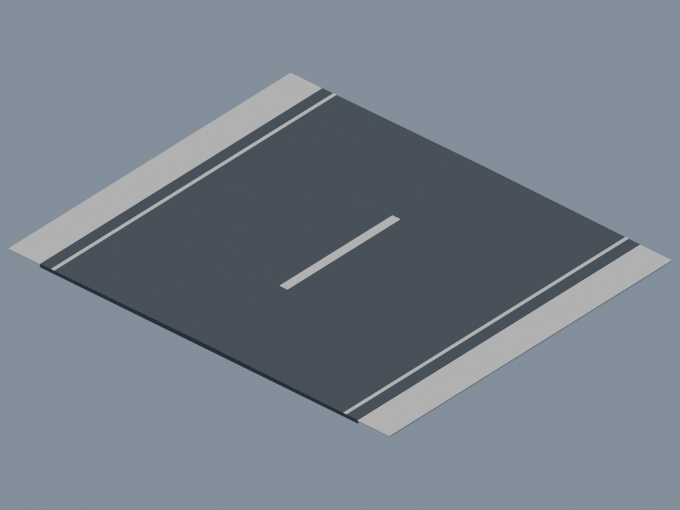
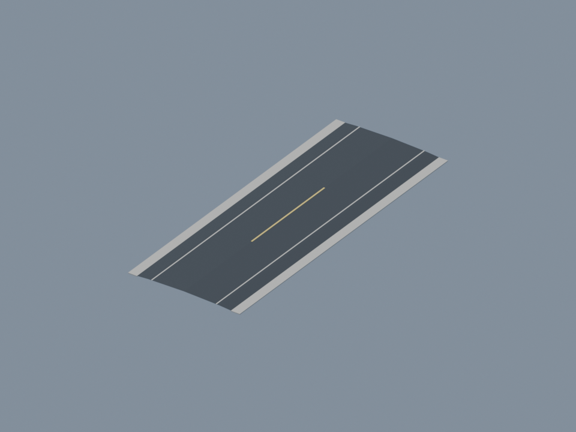
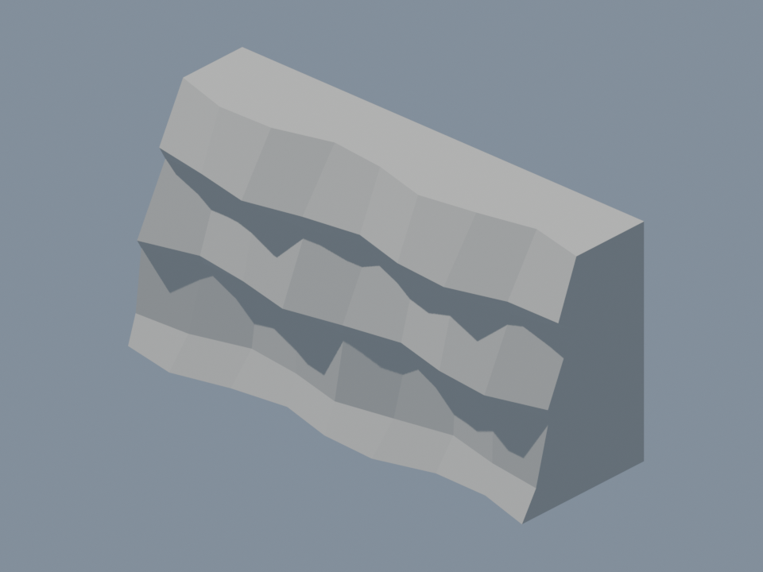

# Outer mission districts

This is a reviewable representative expansion, not a claim that every mission is now a fully
hand-authored large world or that Blender inspection renders prove in-game realism. Current
main at the start of this branch was `d31ed1d` (includes world PR #47). The dirty project root
was not modified. No Studio session was opened, changed, or stopped.

## Coverage and geography

| Measure | Before | After |
|---|---:|---:|
| Horizontal hard limit, each axis | ±2800 studs | ±3800 studs |
| Hard-boundary square | 5600 × 5600 | 7600 × 7600 |
| Flyable square area | 31.36M stud² | 57.76M stud² (+84.2%) |
| Soft recovery starts, each axis | ±2400 | ±3600 |
| Detailed Terrain square | 8000 × 8000 | 8000 × 8000 |
| Ground/sea horizon tile square | 12000 × 12000 | 12000 × 12000 |
| World infrastructure mesh designs | 0 | 3 |

`WorldAirspace.ts` owns horizontal boundaries, spawn limit and tactical radar range. All missions
use the horizontal limits; the three new districts are M3, M5 and M19 only. The other missions
retain their existing populated cores and terrain ridges/islands. The former horizon ridges are
now reachable collision hazards, not invisible level walls. Missions 1–2 retain their existing
island and harbor compositions. No objective, route point, protected boat path, convoy, time
limit or player start was multiplied, displaced or lengthened.

Each new district occupies x=2700..3700, z=-1400..1400: a 1000 × 2800-stud east belt that used
to be behind the hard boundary. Two explicit earthworks operations open a pass through the
old east ridge and restore a supported floor at y=44. Only M5 adds three field-material swaths.
The original mission terrain and targets stay intact outside that rectangle.

- M3: 1400 × 100-stud runway pavement (120 including drainage shoulders), three approved
  aircraft shelters, a radar dish, west access road, service spine, turnoffs, twelve cliff buttresses
  and sixteen approved rock outcrops. Both runway approaches remain clear to z=±850.
- M5: three farmhouse/barn/silo compounds with field swaths, 27 orchard trees, sixteen boundary
  pines and the same road/escarpment system. Inner scatter is reduced by 43 trees, keeping the
  original 140-tree budget while redistributing density into a second agricultural district.
- M19: an inland logistics extension with six container stacks, three scaled office models and
  sixteen pines, road/spur access and the escarpment. It does not invent a second waterfront or
  move the audited harbor/escort canal.

The access road reaches x=2700, near the old playable edge. It is a supported district access,
not a claim of a continuous road connection to every existing mission street. The district is
optional geography, with no new mission objective or HUD waypoint. Existing objective bearings
continue to guide the player back to the authored core. Wide radar range is 4400 (was 3200),
close range stays 1600, and farther objectives continue to pin to its rim.

## Original Blender kit and runtime path

`tools/build-world-kit.py` reuses the repo's mission mesh exporter, validator and static-content
runtime. All geometry is original procedural authorship; no downloads, third-party textures,
marketplace inserts or new asset IDs. The existing uploaded props retain their approved IDs.
The three new geometry JSON files are packaged as server-only StringValues in both Rojo maps.
No upload, moderation submission, publishing or credential use is needed for this implementation.
The existing runtime static mesh API still requires account/place support; its visible fallback
is explicitly reported and must be checked in Studio.

| Kit | Authored bounds X/Y/Z (studs) | Triangles | Vertices | Material meshes |
|---|---|---:|---:|---:|
| RunwayTile | 120 / 1.45 / 100 | 76 | 50 | 2 |
| RoadTile | 38 / 0.98 / 100 | 68 | 50 | 3 |
| CliffTile | 200 / 100 / 66.958328 | 150 | 77 | 1 |

Runways have camber, drainage shoulders, edge lines and center dashes; thresholds are thin
separate paint geometry. Roads have a crowned cross-section, gravel shoulders and paint.
Cliffs have irregular erosion profiles and ledges, with closed back/end caps. These are modest
geometry LOD assets with flat materials, not scanned terrain or photoreal surfaces. They repeat
at authored size; no giant stretched mesh. Existing uploaded buildings/trees keep their original
PBR assets. Road/runway pavement uses Asphalt, road paint does not emit neon light.

The exporter checks bounds, triangle limits, finite dimensions, centered bounds and nondegenerate
triangles. Exact statistics are in `assets/mission/world-kit.stats.json`. Rebuild with:

```sh
/Applications/Blender.app/Contents/MacOS/Blender --background --python tools/build-world-kit.py
```

The generator also writes regenerable .blend/.glb files (ignored) and committed daylight PNG
inspection renders. These show the isolated Blender assets, not a Studio sortie:





## Plan and performance budgets

| Mission | Parts before → after* | Props before → after | Unique designs before → after | Terrain ops before → after | Voxel writes before → after |
|---|---:|---:|---:|---:|---:|
| M3 | 75 → 144 | 86 → 106 | 9 → 13 | 318 → 320 | 61.6M → 88.2M |
| M5 | 24 → 71 | 174 → 183 | 8 → 10 | 232 → 237 | 69.6M → 96.2M |
| M19 | 70 → 117 | 143 → 168 | 12 → 14 | 124 → 126 | 37.3M → 63.9M |

*Plan part entries include a kit placement as one entry, not one engine BasePart. M3 places
14 runway, 35 road and 12 cliff modules (61 models, 5244 additional rendered triangles).
M5/M19 each place 35 road and 12 cliff modules (47 models, 4180 triangles). A module also has
an invisible nonqueryable bounds root; each material is a MeshPart. Template generation occurs
once per kind per server; later placements clone the cache. RenderFidelity remains Automatic.
`WorldKitModels` and `WorldKitFallbacks` distinguish these from uploaded-prop statistics.

The generated table in `world-realism.md` includes conservative kit instance overhead. It is
an estimate, not an engine profiler capture. All 25 planned missions retain their existing
340 plan-parts / 280 props / 20 unique-design / 100M voxel-write / 2.5M hill-cell budgets.
M5 is at 96.24M voxel writes: further earthworks need to reclaim budget first. Terrain operations
still go through bounded TerrainWriter jobs, and no per-frame scenery loop was added. No
streaming was enabled. The extra models replicate under the existing loading gate; device memory,
frame time, mesh API latency and replication duration have not been measured for this branch.

## Flight-agent coordination and travel time

Only the `FlightMath` import and two horizontal-boundary initializer lines change. Acceleration,
cruise, top speed, attitude and controller logic are untouched. The flight agent should retain
that import and use `WorldAirspace.soft/hard` if its patch edits the same initializer block.
`Flight.spec` changes one old coordinate literal to `SoftBoundary + 100`; resolve any concurrent
flight-test edits by preserving the parameterized boundary case. Spawn and radar edits are
world-owned integration changes in CombatService/RadarMath, separate from speed tuning.

The repo currently integrates speed in studs/second; it has no authoritative mph conversion.
Use `seconds = distanceStuds / speedStudsPerSecond`. Below is an explicit **reference assumption
of 1 stud = 1 meter**, so mph × 0.44704 = studs/s. This does not change runtime speed or declare
the flight agent's conversion. Roblox's conventional 0.28 m/stud would make every time below
0.28 times as long. The parent and flight agent must reconcile that choice before acceptance.

| Straight leg | Distance | At current 300 studs/s | At 800 mph reference (357.632 studs/s) | At 3000 mph reference (1341.12 studs/s) |
|---|---:|---:|---:|---:|
| Old full hard-boundary width | 5600 | 18.67 s | 15.66 s | 4.18 s |
| New full hard-boundary width | 7600 | 25.33 s | 21.25 s | 5.67 s |
| Spawn (0,500) to district center (3200,0), XZ | 3238.83 | 10.80 s | 9.06 s | 2.41 s |
| New M3 runway | 1400 | 4.67 s | 3.91 s | 1.04 s |

This footprint is still small for sustained 3000 mph travel. A much larger world needs separated
mission regions and a streaming/replication strategy, not simply bigger ground slabs. Landing,
runway usability at fighter speed, navigation overshoot and mission pacing require actual flight
acceptance with the new speed branch. These districts provide scenery coverage and maneuvering
room, not minutes of cruise travel or a finished landing simulation.

## Validation and acceptance

- `bun run test:offline`: 487 compiled-domain contracts passed in official Luau. This includes
  all 25 plan audits (air corridors/ceilings, targets, support, convoys, full escort hull paths,
  budgets), radar/navigation tests, parameterized flight boundaries, new road-junction checks,
  exact kit bounds, airspace containment and a 25-stud sweep of the runway/approaches.
- `bun run build:place`: roblox-ts and Rojo place build pass. This is not an engine test.
- `bun tools/world-report.ts` and `--check`: regenerate/validate the documented counts.
- Blender generator: all three meshes export, validate, save and render successfully.
- No Roblox Jest run, Studio screenshots, device benchmarks or in-game realism verdict.

Enemy spawns now clamp at ±3500 rather than ±2500 so waves can populate the added belt. Before
exposing an enemy, six rays using the scenery/terrain allowlist probe its center, four 80-stud
hull margins and a 200-stud approach point; altitude is raised to at least 120 studs over the
highest hit. Arrival angles/ranges, wave counts and player spawn stay unchanged. Rays cost only
at spawn. This checks local clearance, not an entire enemy flight path or minimum post-clamp
separation from a player flying at the rim; those remain engine acceptance items.

When the parent can use Studio without displacing the targeting acceptance session:

1. Open the built place separately and fly M3/M5/M19 through the east belt, then M1, M2 and
   representative ocean/plateau missions to check newly reachable ridges and boundaries.
2. Read WorldKitModels/Fallbacks, WorldFallbacks, build seconds, longest terrain job and replica
   readiness. Require zero kit fallbacks for asset acceptance, and verify the meshes replicate
   to the client with static mesh permissions actually enabled.
3. Check street junctions, runway tile seams/paint, shoulder grounding, cliff end seams, prop
   contact, flight-sweep collisions and fallback geometry. PreciseConvexDecomposition on a
   concave ledge may fill recesses; at top speed a long spherecast can meet several tiles.
4. Trigger required/reinforcement waves while in the belt, near a cliff and at the soft rim.
   Confirm no spawn embed, instant lock, terrain collision or navigation dead end.
5. Measure low-end mobile memory, GPU/frame time, preload/content API time and network loading;
   existing Automatic mesh fidelity is not a distance-culling or streaming system. Streaming
   remains off, and would need separate acceptance for targets, collision queries and readiness.
6. Merge the flight change in the parent's review workspace, confirm the actual mph conversion,
   then repeat low passes, boundaries and objectives at 800/3000 mph. Do not claim combined
   acceptance from the standalone world tests.

Remaining authored work: district rollout to the other 24 missions, purpose-built coast/ocean
expansions, organic district edges and more varied cliff assets, long-distance mission/navigation
redesign, runway/taxiway kit conversion of the original airfields, richer surface textures and
an actual measured mobile LOD/streaming policy. Existing core roads/runways remain as before.
